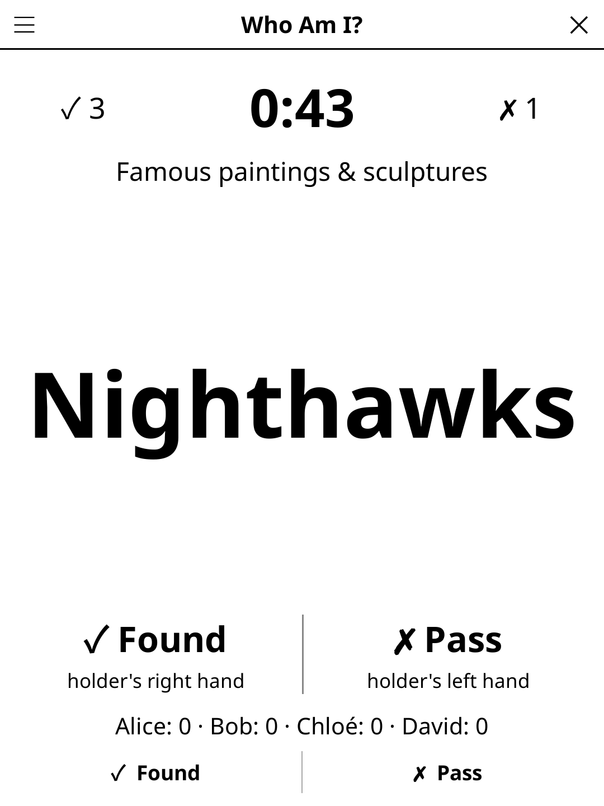

# whoami.koplugin

**Who Am I?** (FR *Qui suis-je ?*) — a forehead guessing party game for
[KOReader](https://github.com/koreader/koreader). Hold the reader screen-out,
the others give clues, guess as many cards as you can before the time runs out.

## Screenshot



## Rules

- Players take turns. The reader shows **“Pass the reader to Alice”**; Alice
  holds it against her forehead (or chest), screen facing the others, and taps.
  A 3-2-1 countdown gives her time to turn the screen away.
- The others give clues — words, sounds, mimes — without saying the word.
- The holder taps with their **right hand** when found (+1), their **left
  hand** to pass. Since the screen faces the others, the holder's right hand
  is the half the others see on the **left**; the labels under the card name
  the holder's hand ("holder's right hand"), so nobody has to work it out.
  The hands can be swapped (**Found side**). On readers with page-turn
  buttons, next page = Found, previous page = Pass.
- When the time is up, the holder sees the turn's cards: found, passed, and the
  one on screen when the time ran out (⏱).
- After the chosen number of rounds (everyone plays once per round), the player
  with the most cards found wins.

## Features

- Big word, readable from a couple of metres: as large as the screen allows,
  wrapping between words, never cut mid-word.
- Countdown of 30, 60 or 90 s; only the timer area refreshes each second.
- 2–12 players, names typed once (one per line) and remembered.
- 18 categories, multi-select (or **Mix**), each its own file loaded only when
  played. Plenty of proper nouns (Einstein, Napoléon, Cléopâtre, Marie Curie,
  Dark Vador, Harry Potter, Louis XIV, la Joconde…); sports legends are retired
  or historical athletes only:

  | Category | EN | FR |
  |----------|----|----|
  | Famous people | 400 | 432 |
  | Pop culture characters | 389 | 371 |
  | Superheroes & villains | 232 | 232 |
  | Cartoons & comics | 215 | 237 |
  | Mythology & legends | 240 | 247 |
  | Movies & series | 425 | 436 |
  | Sports legends (retired or historical) | 224 | 202 |
  | Animals | 400 | 407 |
  | Jobs | 397 | 392 |
  | Countries & cities | 441 | 519 |
  | Monuments | 400 | 391 |
  | Famous paintings & sculptures | 217 | 222 |
  | Inventions & discoveries | 224 | 232 |
  | Objects | 437 | 427 |
  | Food & dishes | 224 | 240 |
  | Musical instruments | 208 | 224 |
  | Mimes & actions | 385 | 381 |
  | Kids (easy) | 232 | 232 |
  | **Total** | **5690** | **5824** |

  With every category loaded (Mix), the cards take about 0.3 MB of memory.

  The card language is its own setting (**Language: FR/EN**), defaulting to
  KOReader's language; the interface follows KOReader.
- Scores are saved when the screen closes; a turn interrupted by closing the
  game is replayed.

## Installation

Copy `whoami.koplugin/` into KOReader's `plugins/` folder, with the shared
`game-common/` library as its `common/` folder (the release zip includes it).
**Who Am I?** then appears in the Tools menu.

## Development

`game.lua` is the game logic (no UI). `test_game_spec.lua` covers it and checks
the card files (every category present, 150+ distinct cards, no excluded
names):

```
busted test_game_spec.lua
```

## License

GPL-3.0
